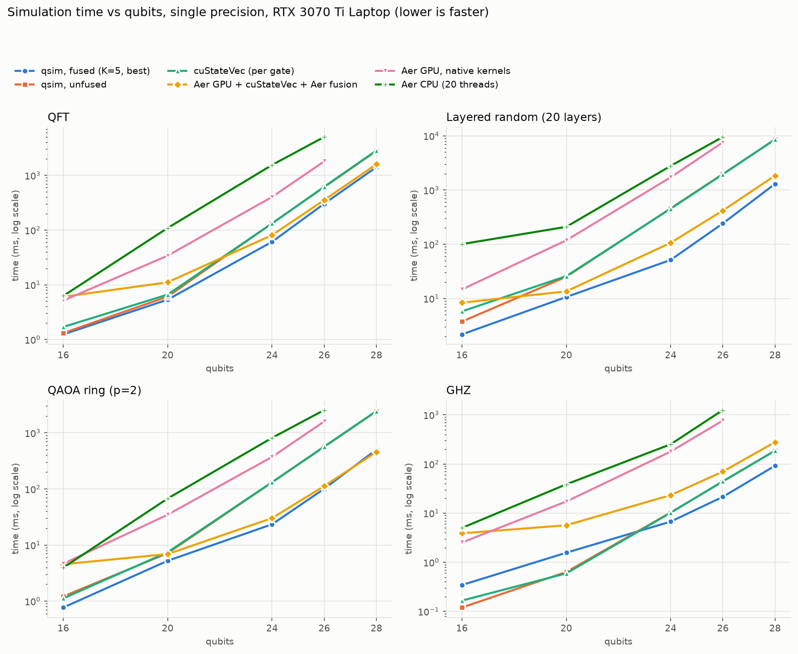
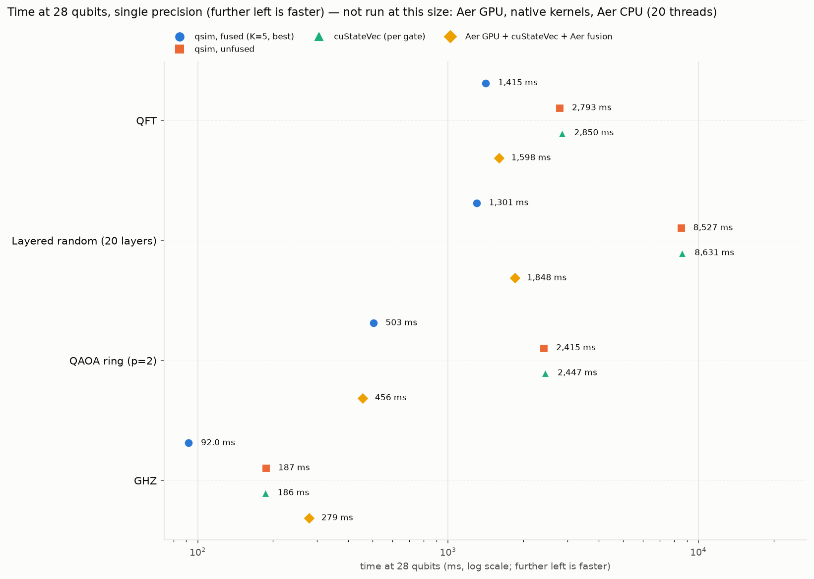

# BENCH.md — measurement log

One entry per measurement or optimisation: what changed, the numbers, and what they mean.
Always note the power state; this laptop's GPU behaves very differently on battery.

---

## 2026-11-19 — M0: toolchain + bandwidth ceiling (provisional)

**Setup:** CUDA 13.1.1 (driver 592.00 supports up to 13.1), MSVC 19.44 (VS Build Tools 2022),
CMake 4.4.2, Visual Studio generator, sm_86. **On battery, Windows "Silent" profile → GPU capped at
55 W (max 120 W), memory clock 6001 MHz.**

`bwprobe` (tools/bwprobe.cu), median of 20, complex64:

| Test | 28 q (2 GiB) | 24 q (128 MiB) |
|---|---|---|
| cudaMemcpy D2D | 286.5 GB/s | 283.7 GB/s |
| copy kernel (float4, grid-stride) | 281.5 GB/s | 273.1 GB/s |
| in-place read-modify-write (float4) | 282.2 GB/s | 199.2 GB/s |

- The driver reports a **384 GB/s** peak in this power state (12 Gbps × 256-bit), not the 448 GB/s
  spec (14 Gbps). We reach ~74% of it, so 282 GB/s is the working ceiling *for now*.
- At 28 qubits a full-state pass (read + write 2 GiB) takes ~15.2 ms → that's the floor for one
  1-qubit gate in this power state.
- ~~Open question: in-place RMW dropped to 199 GB/s at 24 q.~~ Answered below: a one-off.

**Superseded** by the on-AC run above (358 GB/s).

## M3.4: commutation-aware fusion — qsim now ahead of Aer on 3 of 4 circuits

**Why:** M4 showed Aer (cuStateVec backend + its own fusion) 2.5× faster on the layered circuit.
Kernels were on par with cuStateVec, so the gap was the fusion pass: ours was in-order greedy.

**Commuting strategy** (`src/fusion/fuse.cpp`, `fuse_commuting`): keep several open blocks on
pairwise-disjoint qubit sets. A gate joins (merging if needed) the open blocks it touches while the
union stays ≤ K; otherwise it keeps the biggest touched blocks that fit and closes (emits) the rest,
which it has to follow anyway. Gates on disjoint qubits commute, so this is exact. Invariant: for
every qubit, blocks touching it are emitted in input order.

**It isn't always better.** Fused op counts at 28 q (deterministic, no timing):

| circuit | K=3 in-order / commuting | K=4 | K=5 |
|---|---|---|---|
| layered | 450 / **136** | 275 / **130** | 245 / **67** |
| random | 145 / **112** | 104 / **74** | 81 / **58** |
| QFT | 209 / 209 | **140** / 147 | **103** / 116 |
| QAOA | 56 / **53** | **40** / 44 | **31** / 37 |

Keep-the-biggest-blocks loses on the QFT/QAOA ladders. So the default is **Best**: run both (host
side, milliseconds) and keep the lower `pass_cost` (1 per op, 1/2^c for an op with c controls).
`qsim_cli --fuse-mode best|commute|inorder`.

**Correctness:** new [fusion] cases (all three strategies on random circuits K = 1..6; wide layered
circuits with long-range gates; commuting skips past disjoint gates but never past shared-qubit ones;
Best == min cost). 62/62 cases. qiskit_check: 1150 + 700 circuits with commuting/best fusion, CPU and
GPU, f32/f64, K = 1..6, all pass (worst 2.6e-15 f64, 1.5e-7 f32).

**A/B, in-order vs best, interleaved, 28 q f32:** layered −60% (K=3) / −54% / −68% (K=5);
random −15% / −25% / −40%; QFT and QAOA within noise (best picks in-order there, so both sides run
the identical circuit). Noise calibration: QAOA K=4 showed +12.9% between two *identical* fused
circuits, so differences under ~10% in a 3-round A/B aren't meaningful.

> **Contaminated run, discarded (2026-11-20 18:42):** the first A/B of this change ran while a game
> (Ghost of Tsushima) was using the GPU: 99% utilisation, 4.3 GB, 86 °C, SM at 945 MHz. Timings were
> 2–36× off (QFT K=3: 91 s instead of 2.5 s). Only the deterministic op counts from that run are
> used. Benchmark scripts' wrappers now log GPU memory/temperature and check for the game process.

### M4 re-run with best-of-both fusion, K = 5 (2026-11-21)
qsim-fused, Aer GPU + cuStateVec, and raw cuStateVec re-run in interleaved rounds (3); other rows
are from the 2026-11-20 run. Session check: raw cuStateVec within 3% of the day before on every
circuit (QFT-28 2850 vs 2758 ms, layered-28 8631 vs 8382), so the two sessions are comparable.

| 28 q, f32 (ms) | **qsim fused** (was in-order K=4) | Aer GPU + cuStateVec | cuStateVec | qsim vs Aer | qsim vs cuStateVec |
|---|---|---|---|---|---|
| QFT | **1,415** (1,711) | 1,598 | 2,850 | **1.13× faster** (was 0.91×) | **2.0× faster** |
| Layered random | **1,301** (4,529) | 1,848 | 8,631 | **1.42× faster** (was 0.39×) | **6.6× faster** |
| QAOA ring | 503 (502) | 456 | 2,447 | 0.91× (Aer 10% faster) | **4.9× faster** |
| GHZ | **92** (111) | 279 | 186 | **3.0× faster** | **2.0× faster** |

At 24 and 26 qubits qsim-fused is faster than Aer on all four circuits (layered-24: 51 vs 106 ms).
QFT's gain is from K=5 rather than commuting (Best picks in-order there); layered's is from commuting.
Updated charts above in M4 (`docs/img`), full tables in [docs/m4_results.md](docs/m4_results.md).

**Still open:** QAOA-28 (Aer 10% ahead), and small GHZ (16–20 q), where K=5 dense blocks on the lowest
qubits cost more than per-gate application (1.6 vs 0.6 ms at 20 q). A cost model that knows the
kernel's speed per block shape (from `--profile-ops` data) instead of counting passes would address both.

## M4: benchmarks vs Qiskit Aer and NVIDIA cuStateVec

> Results in this section are the original 2026-11-20 run (in-order fusion, K=4). The charts and
> `docs/m4_results.md` now show the M3.4 re-run; see the section above.




**Setup.** 4 circuit families (`bench/circuits.py`: QFT, 20-layer random-circuit-sampling style,
QAOA ring p=2, GHZ) at 16–28 qubits, single precision, RTX 3070 Ti Laptop on AC, 2026-11-20.
`bench/m4_bench.py` runs every backend once per round, 3 interleaved rounds, median; `m4_plot.py`
makes the charts and tables. Same `.qc` file for every backend.

| backend | where | what's timed |
|---|---|---|
| qsim, unfused / fused (K=4) | Windows, native | `qsim_cli --gpu`: all ops queued + final sync, state reset excluded (min of 2 per round) |
| cuStateVec 1.15 (cuquantum-python 26.11) | WSL2 | CUDA events around one `custatevecApplyMatrix` per gate, no fusion |
| Aer 0.18.4 GPU + `cuStateVec_enable` + Aer fusion | WSL2 | Aer `time_taken` (init + run + one `measure_all` sample) after a warm-up |
| Aer GPU, native kernels, default fusion | WSL2 | same; ≤ 26 q (slow) |
| Aer CPU, 20 threads, default fusion | WSL2 | same; ≤ 26 q (slow) |

**Checked before trusting it:** the `.qc` → Qiskit converter matches qsim's CPU simulator on every
family (≤ 2e-16); cuStateVec's final states match Qiskit (≤ 1.5e-16); device copy bandwidth inside
WSL2 is 357 GB/s vs 358 on Windows, so the WSL baselines aren't handicapped on memory-bound work.
For Aer I tried the configurations and report its fastest: native GPU kernels with default fusion
took 1720 ms on layered-24 (fusion off: 1205; fusion_max_qubit 2: 844), cuStateVec backend +
fusion: 105 ms. The table also keeps Aer's native default for reference.

**Results at 28 qubits (ms):**

| circuit | gates | **qsim fused** | qsim unfused | cuStateVec | Aer GPU + cuStateVec | qsim-fused vs cuStateVec | vs Aer GPU + cuStateVec |
|---|---|---|---|---|---|---|---|
| QFT | 420 | **1,711** | 2,793 | 2,758 | 1,550 | **1.61× faster** | 0.91× (Aer 10% faster) |
| Layered random | 830 | **4,529** | 8,527 | 8,382 | 1,782 | **1.85× faster** | 0.39× (Aer 2.5× faster) |
| QAOA ring | 252 | **502** | 2,415 | 2,381 | 461 | **4.75× faster** | 0.92× (Aer 8% faster) |
| GHZ | 28 | **111** | 187 | 185 | 280 | **1.66× faster** | **2.52× faster** |

At 26 qubits vs Aer's native GPU kernels: qsim-fused is **4.8× (QFT), 9.6× (layered), 13.8× (QAOA),
29× (GHZ)** faster; vs Aer CPU on 20 threads: **12–48×**. Full tables: [docs/m4_results.md](docs/m4_results.md), raw times:
`docs/m4_results.json` (regenerate the charts with `python bench/m4_plot.py --in docs/m4_results.json`).

**What it says:**
1. **Kernels: on par with NVIDIA's.** Unfused qsim is within 1.3–1.7% of cuStateVec's per-gate
   time on every family at 28 q (both at the memory floor for 1-qubit gates).
2. **Fusion: behind Aer's.** With fusion, qsim beats per-gate cuStateVec by 1.6–4.8×, but Aer's
   fusion + cuStateVec beats qsim on gate-dense circuits, by 2.5× on the layered circuit. Aer's
   fusion is cost-based and can move gates past gates on other qubits (they commute); qsim's is an
   in-order greedy that closes a block as soon as the next gate doesn't fit. On the layered circuit
   that means a u3 layer on 28 qubits closes 7 four-qubit blocks in a row, and every cz on the
   boundary between two blocks starts a new pass.
3. **Fixed overhead: qsim wins small and shallow.** Aer pays ~3–5 ms per run (16–20 q rows), and
   on GHZ (28 gates) Aer's fusion doesn't help, so qsim is 2.5× faster even at 28 q.

**Next:** commutation-aware fusion: let a gate join an earlier open block if it touches none of the
qubits of the gates in between (disjoint gates commute), and pick block boundaries by cost instead of
first-fit. The layered circuit is the target (4.5 s vs Aer's 1.8 s).

## M3.3: low-qubit blocks — shared-memory tiles (failed), warp shuffles (kept)

**Problem (from M3.2):** dense blocks whose targets are the lowest qubits run far below the floor
with the direct kernel (one thread per group): mat4 {0,1,2,3} 56%, mat5 {0..4} 46%.

### Attempt 1: shared-memory tiles — slower, removed
A block loads a 4096-amplitude tile (low qubits contiguous + high targets) with coalesced loads,
applies the op in shared memory, writes back coalesced. Correct (all tests + Qiskit), but 28 q f32:

| consecutive targets from t | mat2 | mat3 | mat4 | mat5 |
|---|---|---|---|---|
| t = 0, direct → tiled | 95% → 92% | 86% → 74% | 56% → 56% | 46% → 38% |
| t = 12, direct → tiled | 100% → 81% | 98% → 78% | 98% → 63% | 66% → 40% |

Two reasons: (1) within the tile each thread still owns 2^k contiguous elements, so the 32 lanes
hit the same shared-memory banks: the stride problem just moves from L1 to shared memory; (2) the
load → sync → compute → sync → store phases with 2–3 blocks per SM cost ~20% even when targets are
high. Lesson: staging through shared memory doesn't help if the access pattern inside it is the same.

### Attempt 2: one lane per amplitude + warp shuffles — kept for packed low targets
`apply_kt_shfl<T,K>`: a group's 2^k members are 2^k adjacent lanes of one warp. Each lane loads one
amplitude (for low targets: consecutive lanes, consecutive addresses), gets the others with
`__shfl_sync`, and multiplies by its own matrix row held in registers for the whole kernel. No shared
memory, no barriers; also handles controls. 38–95 registers (f32), no spills.

28 q f32, % of ceiling (direct → shuffle):

| consecutive targets from t | mat2 | mat3 | mat4 | mat5 |
|---|---|---|---|---|
| t = 0 | 95 → 98% | 86 → **97%** | 56 → **97%** | 46 → 51% |
| t = 1 | 99 → 98% | 97 → 97% | 81 → **94%** | 76 → 48% |
| t = 2 | 100 → 98% | 87 → 96% | 85 → 85% | 88 → 43% |
| t ≥ 4 | ~100 → 70–93% | ~99 → 35–74% | ~98 → 34–58% | 61–74 → 21–32% |
| spread targets | 97–100 → 70–95% | 80–100 → 35–69% | 69–98 → 35–52% | 54–63 → 23–33% |

Shuffle wins only when the targets are packed into the lowest bits; once they spread upwards, a
group's members are far apart and its loads scatter. mat5 never really wins (64 shuffles per
amplitude). Low controls aren't helped either (cswap c=0: 47% → 49%).

**Auto rule** (`use_shuffle`): shuffle iff the highest target ≤ k (k = 5: exactly {0..4}).
The sweep alone suggested "≤ k + 1", but in-circuit profiling (new `qsim_cli --profile-ops`, which
times every op and groups by shape) showed fused {2,3,4,5} at 14.2 ms direct vs 18.4 ms shuffle,
while {0,1,2,3} went **23.7 → 14.8 ms**. Isolated sweeps of 32 identical ops don't fully predict
in-circuit behaviour; check both.

### Benchmarking lesson: thermal drift
Back-to-back runs drift ~10% on this laptop as it heats: in one profile, direct-kernel blocks whose
code hadn't changed got 10% slower in the second run, and QFT-28 K=5 measured 1374 ms early in the
session and 1700 ms after hours of benchmarking. `fusion_bench.py --ab A,B` now alternates the two
settings run by run (median of 5 each), so both see the same conditions. Use it for every A/B claim.

**Result**, interleaved A/B, 28 q f32, direct vs auto (with shuffle):

| circuit | K=3 | K=4 | K=5 |
|---|---|---|---|
| layered | **−5.5%** (4342 → 4102 ms) | **−7.6%** (5077 → 4690) | +1.9% |
| GHZ | 0% | −3.4% | **−6.0%** |
| QFT | 0% | −0.6% | +0.7% |
| random | +0.1% | −0.2% | −2.0% |

The worst block is fixed (23.7 → 14.8 ms), but only ~1 fused block in 14 sits on the lowest qubits,
so whole circuits gain 0–8%. Correctness: 60/60 Catch2 cases (new: shuffle and direct forced on
4–17 qubit states, every target layout, controlled multi-target ops); qiskit_check GPU f64 fuse 4
200/200 (7.9e-16), f32 forced shuffle 200/200 (2.6e-7).

**Still open:** mat5 on low qubits (~50%), {2..5}-style blocks (~85%), low-qubit controls (48%).
Bigger remaining lever: fewer passes (fusion that can reorder commuting gates), or applying several
fused blocks per pass over memory.

## M3.2: gate fusion

**Pass** (`src/fusion/fuse.cpp`, `qsim_cli --fuse K`): greedy and order-preserving. Walk the ops, keep
adding to the current block while the union of touched qubits (targets + controls) is ≤ K, else
close it. A block of ≥ 2 ops becomes one dense 2^q × 2^q matrix (built in double on the host by
applying each op to the block's columns); a single-op block is emitted unchanged, so a lone cx keeps
its control and its half-state cost. Host cost is small (QFT-28: 420 → 103 ops in a few ms).

**Correctness:** 5 new [fusion] cases (fused == unfused for K = 1..6 on 8 random circuits; the block
rules; GPU running fused circuits, f32 and f64). qiskit_check (now also with `p`/`cp`): CPU fuse 3
200/200 (6.2e-16); GPU f64 fuse 5 200/200 (8.9e-16); GPU f32 fuse 4 200/200 (**8.2e-8**, lower than
unfused 2.6e-7 because fused matrices are built in double); GPU f64 fuse 6, ≤ 16 q 150/150 (1.1e-15).

**Results** — `bench/fusion_bench.py`, 28 q f32 GPU, median of 3, on AC. ms = whole circuit;
ops = kernel launches after fusion.

| circuit | gates | unfused | K=2 | K=3 | K=4 | K=5 | best |
|---|---|---|---|---|---|---|---|
| QFT (h + cp ladder + swaps) | 420 | 2793 ms | 392 ops / 2612 | 209 / 2532 | 140 / 1725 | **103 / 1472** | **1.90×** (K=5) |
| layered (u3 on all + cz pairs, 20 layers) | 830 | 8521 | 550 / 5162 | **450 / 4371** | 275 / 5005 | 245 / 5288 | **1.95×** (K=3) |
| GHZ | 28 | 189 | 27 / 176 | 14 / 169 | **9 / 122** | 7 / 134 | **1.55×** (K=4) |
| random mix (far-apart qubits) | 200 | 1837 | 177 / 1565 | 145 / 1275 | **104 / 1104** | 81 / 1167 | **1.66×** (K=4) |

Launch counts drop 3–4×, run time only 1.6–1.95×: fused launches cost more than the 12 ms floor
(layered K=4: 18 ms per launch; QFT K=5: 14 ms). Bigger K stops helping (layered peaks at K=3).

**Why: dense blocks on the lowest qubits are slow.** Same op, 64 copies, 28 q f32:

| block targets | ms/op | % of ceiling |
|---|---|---|
| mat3 {0,1,2} / {12,13,14} | 14.3 / 12.2 | 84% / 98% |
| mat4 {0,1,2,3} / {2..5} / {12..15} / {24..27} | 21.9 / 14.0 / 12.4 / 12.1 | **55%** / 85% / 97% / 99% |
| mat5 {0..4} / {12..16} | 26.7 / 12.2 | **45%** / 98% |

With targets 0..k-1 each thread's group is 2^k *contiguous* amplitudes (128–256 B in f32), so the
32 lanes of a warp sit 128–256 B apart: every load instruction uses 8 B from each of 32 different
lines and relies on L1 keeping them for the thread's other 2^k − 1 loads. With many warps in flight,
L1 thrashes. Fusion makes this common: blocks are naturally on neighbouring qubits.

**Next (M3.3):** stage low-qubit blocks through shared memory: a thread block loads a contiguous tile
with fully coalesced loads, applies the matrix from shared memory, writes the tile back coalesced
(the plan's "shared-memory blocking"; also the fix for low-qubit controls). Then a per-op timing
mode to attribute each fused launch's cost, and a cost-aware fusion (choose K per block).

## M3.1: multi-target kernel — compile-time k, matrix in the argument block

### Found on the way: everything had been compiled for sm_75
`ptxas -v` (now always on, `QSIM_PTXAS_INFO`) printed `for 'sm_75'`. `CMAKE_CUDA_ARCHITECTURES`
was set *after* `project()`, which had already filled in nvcc's default (75), so since M0 every kernel
was a Turing build that the driver JIT-compiled from PTX at load. Fixed by setting it before
`project()`. Re-measured the M2 kernels as native sm_86: within ±1% of the M2 numbers (h 98–100%,
cx 48–100%, mat2 61–68%, mat3 46–58%), so earlier results stand.

### Diagnosis (hypothesis 3 from M2: confirmed)
ptxas: `apply_kt` has a **512-byte stack frame (f32), 1024 (f64)**: the `in[64]` array indexed by a
runtime `dim` can't live in registers. ncu, one `mat3` op at 24 q f32 (`profiles/m3-kt-before`), ideal
traffic = 134.2 MB read + 134.2 MB written:

| | M2 `apply_kt` | M3 `apply_kt_fixed<f,3>` |
|---|---|---|
| DRAM read / write | 159.5 / **264.8 MB** | **134.3 / 133.5 MB** (= ideal) |
| local-memory load / store sectors | 33.6 M / 4.2 M (1.07 GB of L1 traffic) | **0 / 0** |
| instructions executed | 60.2 M | 32.1 M |
| registers / warps active | 41 / 69% | 53 / 64% |
| kernel time (ncu, base clocks) | 1.61 ms | **0.96 ms** |

Writes were 2× ideal: spilled `in[]` lines get evicted to DRAM. Local loads were 8 per amplitude
because the inner loop re-reads `in[c]` for every output row.

### Fix
`apply_kt_fixed<T, K>` for K = 2..4: K is a template parameter so every loop fully unrolls and
`in[]` is registers; matrix + member offsets are passed by value in the kernel arguments
(`__grid_constant__`, up to 16.6 KB, fine since CUDA 12.1 on sm_70+), so every matrix read is a
constant-bank broadcast. K = 6 keeps the M2 kernel.

K = 5 needed two more steps:
1. Same kernel: **25% of ceiling**. The 8 KB (f32) matrix exceeds the per-SM constant cache, and 167
   registers leave 8 warps per SM.
2. Matrix copied to shared memory per block, all loops unrolled: **5%** (215–224 ms/op). ptxas:
   **7.5 KB spills** per thread (f32): the compiler hoisted all 1024 shared loads into registers.
3. Shared memory + only the inner loop unrolled (`#pragma unroll 1` on rows): **82–97%**, 91 registers,
   no spills.

### Results — 28 q f32, `bench/gpu_sweep.py`, median of 5 (k=5: 3), on AC

| Op | M2 | **M3.1** | Notes |
|---|---|---|---|
| mat2, all 28 targets | 58–67% | **97–100%** | |
| mat3, all 28 targets | 46–58% | **99–101%**; dips 81–92% at t = 14, 15, 19 | dips: qubit 0 or 1 among the targets |
| mat4, all 28 targets | — | **95–98%**; dips 68–86% at t = 14, 18, 19, 23, 24 | same low-qubit effect |
| mat5, t = 0/7/14/21/27 | — (generic: ~25% est.) | **82–97%** | shared-memory variant |

f64, t = 0/7/27: mat2 40–47% (was 36%), mat3 21–23% (was 19%), mat4 11%, mat5 6%. Time doubles per
extra target (51 → 105 → 215 → 410 ms): FP64-bound. mat5 = 2^28 × 32 complex MACs × 8 flops in 0.41 s
≈ 168 GFLOP/s, ~60% of this GeForce's FP64 peak (1/64 of FP32). Nothing to gain without FP32.

Correctness: new [cuda] case with one op of every k = 2..6 (scattered, all-low, all-high, controlled);
53/53 Catch2 cases, qiskit_check gpu f64 200/200 (9.2e-16), f32 200/200 (2.6e-7; seed 9: 2.55e-7),
18 q 300/300 (1.7e-15).

**Remaining M3 targets:** low qubits (0/1) as controls (48%) or as non-first targets (68–92%): every
32-byte sector fetched is partly waste. Then gate fusion: every kernel is now at the memory floor,
so fewer passes over the state is the only way left to go faster.

## M2: naive GPU kernels — one launch per op

**Kernels** (`src/cuda/statevector.cu`): `apply_1t` (one thread per amplitude pair, 2x2 matrix in
kernel arguments) and `apply_kt` (one thread per group of 2^k, runtime `dim`, matrix + offsets in
global memory, gathered amplitudes in a per-thread array). Both use the same insert-zero-bit group
enumeration as the CPU, so no thread skips work. 256-thread blocks, grid capped at 32 × SMs,
grid-stride loops. Measurement: Thrust transform_reduce / transform_inclusive_scan / vectorised
upper_bound, uniforms drawn on the host exactly like the CPU (same seed → same samples).

**Correctness:** 12 new [cuda] Catch2 cases (GPU vs CPU reference: every target position, every
control/multi-target kind incl. a 6-target `mat`, 12 random circuits up to 15 q, sampling and
measurement identical to the CPU for the same seed). qiskit_check --backend gpu: 200/200 f64
(9.2e-16), 200/200 f32 (2.6e-7), 300/300 f64 up to 18 q / depth 80 (1.7e-15).

**Bandwidth sweep** — `bench/gpu_sweep.py`, 28 qubits, 64 identical ops per run, median of 5, on AC.
Bandwidth counts the amplitudes an op actually touches (read + write; a controlled op touches half),
as a % of the 358 GB/s ceiling. Floor for a full pass at 28 q f32 = 12.0 ms.

| Op (f32, 28 q) | ms/op | % of ceiling | Notes |
|---|---|---|---|
| `h t`, every t = 0..27 | 11.98–12.25 | **98–100%** | already at the memory limit, at every target position |
| `cx c t`, c ≥ 4 | 6.00–6.28 | **96–100%** | touches half the state, takes half the time |
| `cx c t`, c = 2, 3 | 6.60–6.67 | 90–91% | |
| `cx c t`, **c = 0, 1** | 12.1–12.5 | **48–49%** | control on a low qubit: touched amplitudes are interleaved with untouched ones, so every 32-byte sector fetched is half waste |
| `mat2` (dense 4x4), every t | 17.8–20.7 | **58–67%** | not memory-bound: see below |
| `mat3` (dense 8x8), every t | 20.7–26.3 | **46–58%** | worst when qubit 0/1 is among the targets in some positions |

| Op (f64, 28 q, t = 0/14/27) | ms/op | % of ceiling |
|---|---|---|
| `h` | 29.0–29.7 | 81–83% |
| `mat2` | 66.6–67.4 | 36% |
| `mat3` | 124–126 | 19% |

What this says (hypotheses for M3, to confirm with ncu):
1. **1-target f32 is done**: 98–100% at every target, including t = 0 where pairs are adjacent.
   Gate fusion (fewer passes), not a faster kernel, is the only way to beat 12 ms/gate here.
2. **Low-qubit controls waste half the bandwidth.** Fix candidates: have each thread handle both
   halves of the control-0 region (i.e. treat low controls as targets with an identity block), or
   remap qubits so controls never sit on bits 0–1.
3. **`apply_kt` is far from the memory limit even in f32.** Arithmetic is ~32 flops/amplitude for
   mat2, a few % of FP32 peak, so it's not compute. Likely culprits: `in[64]` indexed with a runtime
   `dim` lives in local memory (spills), and matrix/offset reads from global memory every iteration.
   Fix: template the kernel on k so the arrays become registers and the loops unroll; matrix in
   shared or constant memory.
4. **f64 multi-target is FP64-bound**: GeForce Ampere runs FP64 at 1/64 of FP32. mat3 is ~64
   flops/amplitude → ~140 GFLOP/s, roughly half the card's FP64 peak. f64 is for validation; f32 is
   the performance target (as for cuStateVec benchmarks).
5. Metric note: the first sweep run used "full-pass equivalent" bandwidth, which showed controlled
   gates at "200%". The CLI now counts touched bytes only; all numbers above use that.

## M1: CPU reference v2 — insert-bit enumeration + 1-target fast path

**Change:** groups are enumerated directly (insert a 0 at every target/control position, ascending,
then OR in the control mask) instead of scanning 2^n indices and skipping. One-target ops get a
register-only 2x2 path in the state's precision with a plain complex multiply (`cmul`, avoiding
std::complex's Annex G NaN handling). Multi-target ops keep v1's gather/multiply/scatter.
Same circuits, same machine, on AC, median of 5 (3 for 24 q):

| Circuit | v1 f64 | **v2 f64** | v1 f32 | **v2 f32** | speedup (f64 / f32) |
|---|---|---|---|---|---|
| 20 q, 200 × `h` | 5.09 ms/op | **1.67 ms/op** (20.1 GB/s) | — | **1.41 ms/op** | **3.1×** / — |
| 24 q, 200 × `h` | — | **39.3 ms/op** (13.7 GB/s) | — | — | — |
| 16 q, 200 random | 0.24 | **0.14** | 0.25 | **0.15** | 1.7× / 1.7× |
| 20 q, 200 random | 4.30 | **3.32** | 4.30 | **2.49** | 1.3× / 1.7× |
| 24 q, 50 random | 105 | **84** (spread 49–86) | 100 | **52** | 1.3× / 1.9× |

Correctness unchanged: 39/39 Catch2 cases; qiskit_check f64 200/200 (9.9e-16) and 500/500 (2.0e-15);
f32 200/200 (2.6e-7, was 1.2e-7: 1-target gates now compute in float) and 300/300 at ≤ 16 q (3.1e-7).

- 1-target gates now run at ~20 GB/s at 20 q, about what one core can stream from DRAM, and f32 is
  finally faster than f64. That path is memory-bound now.
- Random circuits only gain 1.3–1.9× because ~1/3 of their ops have 2–3 targets (swap, cswap,
  2–3 qubit `mat`), which still go through the generic gather/scatter loop. A 2-target register path
  would be the next CPU win, but the CPU code is the reference, not the product: the GPU work in
  M2/M3 is where speed matters.
- 24 q timings vary a lot run to run (49–86 ms/op for v2 f64): 256 MiB states, page faults/thermal.
  Use median of ≥ 5 at this size.

## M1: CPU reference v1 — general `apply` (scan all 2^n indices, skip non-matching)

**Setup:** single thread, Release, on AC. `qsim_cli <file> --reps 3`, median. Circuits from
`tests/qiskit_check.py emit --seed 7` (mixed gates incl. controlled and 1–3 qubit `mat`).

| Circuit | f64 per op | f32 per op | f64 "full-pass GB/s" |
|---|---|---|---|
| 16 q, 200 random ops | 0.24 ms | 0.25 ms | 8.7 |
| 20 q, 200 random ops | 4.30 ms | 4.30 ms | 7.8 |
| 24 q, 50 random ops | 105 ms (spread 74–108) | 100 ms | 5.1 |
| 20 q, 200 × `h` only | 5.09 ms | — | 6.6 |

Correctness: all 39 Catch2 cases; qiskit_check 200/200 f64 (worst 9.9e-16), 200/200 f32 (1.2e-7),
500/500 f64 depth ≤ 100 (2.0e-15).

- **f32 is no faster than f64** → this loop is bound by per-index overhead (2^n iterations, branch
  per index, gather/scatter through small vectors, a dense 2^k matmul in double), not by memory.
- Next: a dedicated 1-target path (pair counter + `insert_zero_bit`, matrix converted to `amp_t`
  once, no gather vectors) and controls by inserting bits instead of skipping. Re-measure.

## 2026-11-19 — M0: the real ceiling (on AC) ← use this one

**Setup:** plugged in, Windows scheme still "Silent", GPU in P0, memory at its **6001 MHz max**,
SM 1620 MHz, 66 W, 73 °C. Three runs each:

| Test | 28 q (2 GiB) | 24 q (128 MiB) |
|---|---|---|
| cudaMemcpy D2D | 358.7–359.2 GB/s | 356.7–357.1 GB/s |
| copy kernel (float4) | 357.5–358.1 GB/s | 355.7–356.2 GB/s |
| in-place RMW (float4) | 357.9–358.5 GB/s | 355.2–356.2 GB/s |

- **Working ceiling: 358 GB/s**, 93% of the 384 GB/s driver peak. Every gate kernel is scored as a
  % of this number.
- This GPU's memory maxes out at 6001 MHz (12 Gbps × 256-bit = 384 GB/s) even on AC in P0, so the
  448 GB/s spec-sheet figure doesn't apply to this laptop. A Turbo profile raises power and core clocks,
  not the memory clock, so it shouldn't move a memory-bound ceiling.
- Floor for one full-state pass (read + write): **12.0 ms at 28 q**, 24.0 ms at 29 q (complex64).
- Battery vs AC: 282 → 358 GB/s (+27%). **Benchmark only on AC**, and log the power state.

## 2026-11-19 — M0: first Nsight Compute profile

**How:** GPU counters stay admin-only (Windows default, by choice), so profiling goes through
`tools/ncu-admin.ps1`, which runs ncu elevated (one UAC prompt) and saves `profiles/<name>.ncu-rep`.
Reading a report needs no admin. Still on battery / Silent.

```
.\tools\ncu-admin.ps1 -Name m0-probe24 --set full --kernel-id "::regex:copy_f4|scale_inplace_f4:4" `
    C:\Users\akksh\Claude\gpu-qsim\build\Release\bwprobe.exe 24
ncu --import profiles\m0-probe24.ncu-rep --page raw --csv --metrics gpu__time_duration.sum,dram__bytes_read.sum,...
```

| Kernel (24 q, 128 MiB) | Time | DRAM read | DRAM write | Effective | L2 hit | Warps active |
|---|---|---|---|---|---|---|
| copy_f4 | 944.8 µs | 134.2 MB | 133.7 MB | 283 GB/s | 50.0% | 93.8% |
| scale_inplace_f4 | 946.3 µs | 134.2 MB | 133.6 MB | 283 GB/s | 50.0% | 93.5% |

- Both kernels move exactly the buffer size in and out: no extra DRAM traffic, so in-place
  read-modify-write costs the same as a copy. Gate kernels can work in place without penalty.
- L2 hit rate of 50% is the expected pattern for streaming: reads miss, writes hit (they're allocated in L2).
- ncu reported the DRAM clock at **5.49 GHz** during profiling, and nvidia-smi showed 5501 MHz current /
  6001 MHz max on battery. If the memory really runs at 5.5 GHz on battery, the true peak is ~352 GB/s
  and 283 GB/s is ~80% of it, which is normal. (ncu locks clocks to base by default, so this is a hint,
  not proof; recheck plugged in.)
- **The 199 GB/s result was a one-off.** Four unprofiled reruns of `bwprobe 24`: memcpy 283.7–284.0,
  copy 280.1–281.6, in-place 280.7–281.3 GB/s. Most likely a clock/power-state transition on battery.
  Lesson: always run benchmarks several times and report the spread.

## 2026-11-19 — M0: baselines (WSL2)

GHZ, 20 qubits, complex64, `bench/m0_smoke.py` — correctness check, not a benchmark:

| Backend | Time | Fidelity vs exact |
|---|---|---|
| Qiskit Aer 0.18.4, CPU | 66.5 ms | 0.9999999 |
| Qiskit Aer 0.18.4, GPU | 41.6 ms | 0.9999999 |
| cuStateVec (cuquantum-python 26.11) | 0.96 ms | 0.9999999 |

Aer numbers include Python/transpile-cache/result-copy overhead; M4 must time the simulation alone.
