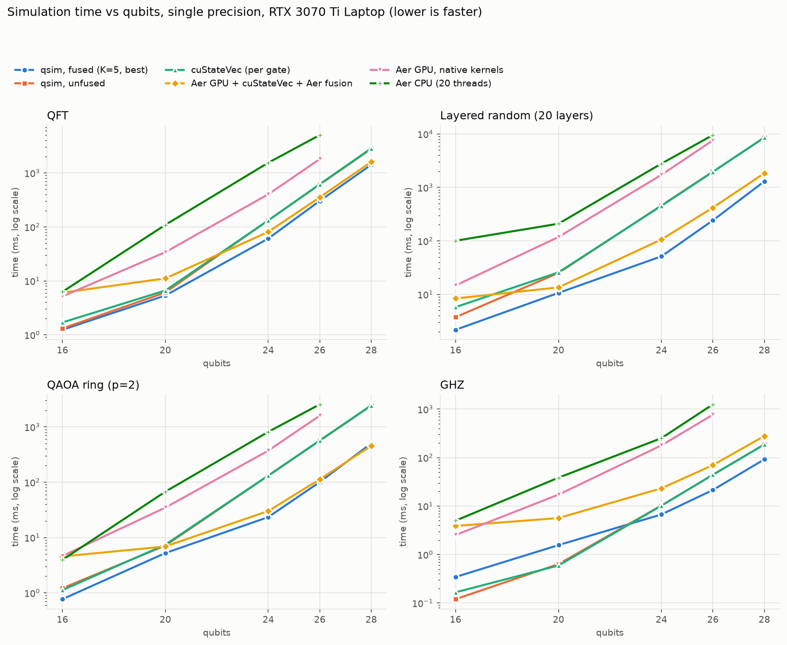

# gpu-qsim

[](https://github.com/Akkshar/gpu-qsim/actions/workflows/ci.yml)

A state-vector quantum circuit simulator in C++20 and CUDA, built from scratch, optimised with
Nsight Compute, and benchmarked against Qiskit Aer and NVIDIA cuStateVec.

On an RTX 3070 Ti Laptop GPU (8 GB, 358 GB/s measured), single precision, 28 qubits:

| circuit | **gpu-qsim** | NVIDIA cuStateVec (per gate) | Qiskit Aer GPU (cuStateVec backend + Aer fusion) |
|---|---|---|---|
| QFT (420 gates) | **1.42 s** | 2.85 s (2.0× slower) | 1.60 s (1.13× slower) |
| Layered random, 20 layers (830 gates) | **1.30 s** | 8.63 s (6.6× slower) | 1.85 s (1.42× slower) |
| QAOA ring, p=2 (252 gates) | 0.50 s | 2.45 s (4.9× slower) | **0.46 s** (1.10× faster) |
| GHZ (28 gates) | **0.09 s** | 0.19 s (2.0× slower) | 0.28 s (3.0× slower) |

At 26 qubits it is 5–29× faster than Aer's own GPU kernels and 12–48× faster than Aer on 20 CPU
threads. Every number is reproducible with the scripts in `bench/`; method, caveats and the full
optimisation log (including what didn't work) are in [BENCH.md](BENCH.md).



## What's in it

- **CUDA backend**: one kernel launch per op, every kernel measured against the memory-bandwidth
  floor. 1-qubit gates and dense 2–4-qubit blocks run at 95–100% of the measured 358 GB/s at most
  target positions, 5-qubit blocks at 82–97%; without fusion it is within 2% of cuStateVec.
- **Gate fusion**: merges gates into dense blocks of up to K qubits, with a commutation-aware strategy
  (gates on disjoint qubits commute, so blocks can stay open past unrelated gates) and an in-order one;
  the default keeps whichever needs fewer passes. 2.0–6.6× faster than per-gate application at 28 qubits.
- **CPU reference simulator**: simple, single-threaded, the ground truth the GPU is tested against.
- **Inputs**: OpenQASM 2.0 (qelib1 gates, parameter expressions, register broadcasting) and a small
  line-based `.qc` format. **Outputs**: final state, probabilities, sampled counts, single-qubit
  measurement.
- **Python bindings** (nanobind) with NumPy output.
- **Tests**: 67 Catch2 cases plus a Qiskit cross-checker that runs thousands of random circuits
  (CPU and GPU, f32 and f64, fused and unfused, `.qc` and Qiskit's own QASM export) and compares every
  amplitude: worst error 3e-15 in double precision, 3e-7 in single.

## Quick start (Windows, CUDA 13.1, VS 2022 Build Tools)

```powershell
uv venv --python 3.12 .venv
uv pip install --python .venv\Scripts\python.exe -r tests\requirements.txt nanobind pytest
.\build.ps1 -Test                       # build everything, run Catch2 + pytest
```

On Linux, or without a GPU (CUDA is optional; CPU-only builds skip the GPU backend and its tests):

```bash
cmake -S . -B build -DCMAKE_BUILD_TYPE=Release && cmake --build build -j
./build/qsim_tests "~[cuda]"
```

### Command line

```powershell
.\build\Release\qsim_cli.exe examples\bell.qasm --shots 1000
.\build\Release\qsim_cli.exe bench\circuits\m4\qft28.qc --gpu --f32 --fuse 5 --reps 3
.\build\Release\qsim_cli.exe circuit.qasm --gpu --profile-ops      # time per op shape
```

```
counts (1000 shots, seed 7, 2 distinct outcomes; bitstring = qubit 1 ... qubit 0)
  00     514  (0.5140)
  11     486  (0.4860)
```

### Python

```python
import sys; sys.path.insert(0, "python")
import qsim

c = qsim.Circuit(3).h(0).cx(0, 1).cx(1, 2)
qsim.statevector(c)                     # NumPy complex64 array, Qiskit qubit order
qsim.sample_counts(c, shots=1000)       # {'000': 482, '111': 518}

c = qsim.Circuit.from_qasm(open("examples/qft4.qasm").read())
qsim.statevector(c, device="cpu", precision="f64", fuse_qubits=0)
```

## How it works

**State vector.** n qubits = 2^n complex amplitudes; qubit 0 is the least significant bit of the
index (Qiskit's convention). A 1-qubit gate on qubit t mixes every pair of amplitudes whose indices
differ only in bit t.

**Indexing without branches.** Instead of looping over all 2^n indices and skipping half, thread k
computes its pair directly: insert a 0 bit at position t into k (`insert_zero_bit`), then OR in
`1 << t` for the partner. Ops with several targets and controls insert a 0 at every target and
control position (lowest first) and OR in the control mask, so no thread ever does wasted work.
The same function drives the CPU reference and every CUDA kernel.

**Kernels** (`src/cuda/statevector.cu`):

| kernel | used for | how |
|---|---|---|
| `apply_1t` | 1 target | one thread per amplitude pair, 2×2 matrix in kernel arguments |
| `apply_kt_fixed<T,K>` | 2–4 targets | K is a template parameter, so loops unroll and the group stays in registers; matrix in the argument block (`__grid_constant__`, constant-cache broadcast) |
| `apply_kt_smem<T,5>` | 5 targets | matrix too big for the constant cache: copied to shared memory, inner loop unrolled only (full unrolling spilled 7.5 KB/thread) |
| `apply_kt_shfl<T,K>` | targets packed in the lowest qubits | one lane per amplitude, group members exchange values with warp shuffles, so loads stay coalesced |
| `apply_kt` | 6 targets | generic fallback |

**Fusion** (`src/fusion/fuse.cpp`). Each op costs one pass over the 2–4 GB state whatever its size,
so dense 5-qubit blocks are almost free compared with doing their gates one by one. The pass is exact:
it multiplies the gates' matrices on the host in double precision.

## What didn't work (details in [BENCH.md](BENCH.md))

- **Shared-memory tiles for low-qubit blocks** were slower everywhere: the bad access stride just moved
  from L1 into shared-memory bank conflicts. Replaced by the warp-shuffle kernel.
- **Unrolling everything** for 5-qubit blocks made the compiler hoist 1,024 shared-memory loads and
  spill 7.5 KB per thread (5% of bandwidth). Unrolling only the inner loop: 82–97%.
- **Commutation-aware fusion alone** was worse than in-order on QFT/QAOA ladders, hence "best of both".
- **Benchmarking on a laptop**: thermal drift is ~10% between back-to-back runs, as large as many
  effects measured, so A/B comparisons alternate the two settings run by run. One run that overlapped
  a game on the same GPU was 2–36× off and was discarded.
- **A silent build bug**: for most of the project every kernel was compiled for sm_75 and JIT-compiled
  by the driver, because CMake's CUDA architecture default was set before mine. Found from `ptxas -v`
  output; re-measured (no change, within 1%).

## Layout

```
include/qsim/   circuit IR, gates, bits, CPU/CUDA state vectors, fusion
src/            cpu/, cuda/, fusion/, io/ (.qc parser, OpenQASM 2.0 parser)
tools/          qsim_cli (run, sample, profile), bwprobe (memory-bandwidth ceiling), ncu-admin.ps1
python/         nanobind bindings (src/) and the qsim package
tests/          Catch2 suites, qiskit_check.py (random circuits vs Qiskit), test_python.py
bench/          circuit generators, sweeps, fusion A/B, M4 benchmark vs Aer/cuStateVec, plots
docs/           charts and full benchmark tables
BENCH.md        measurement log; docs/dev-notes/ the original plan and working notes
```

## Limitations

- Single GPU, state must fit in device memory: 29 qubits in f32 / 28 in f64 on 8 GB.
- GeForce FP64 throughput is 1/64 of FP32, so double precision is for validation, not speed.
- No noise models, no mid-circuit measurement or classical control, no custom QASM `gate` definitions.
- Built and benchmarked on one machine (Windows, CUDA 13.1, sm_86); the CPU parts and tests also
  build on Linux (CI).
